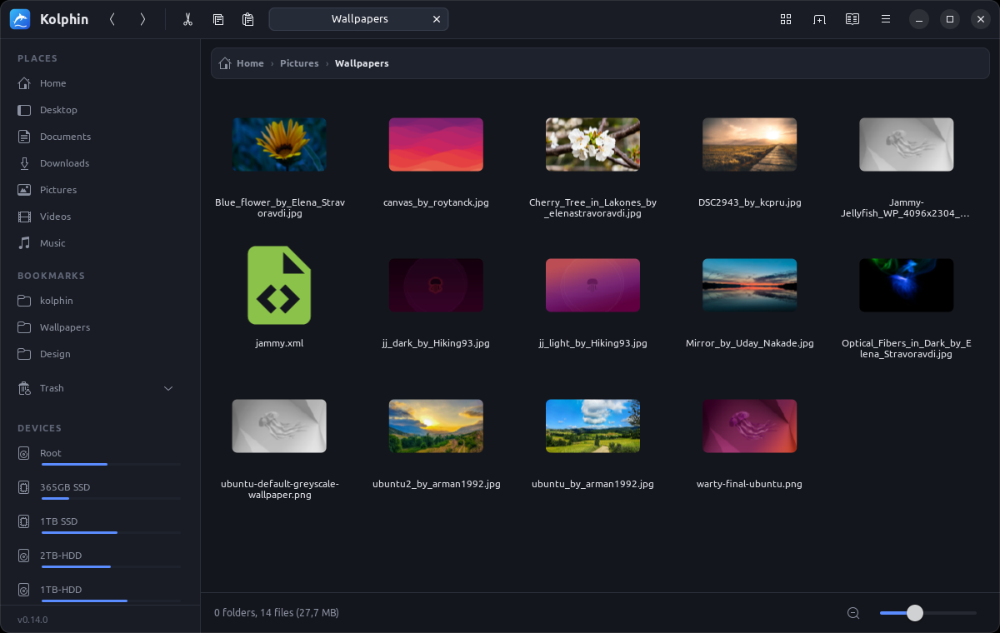
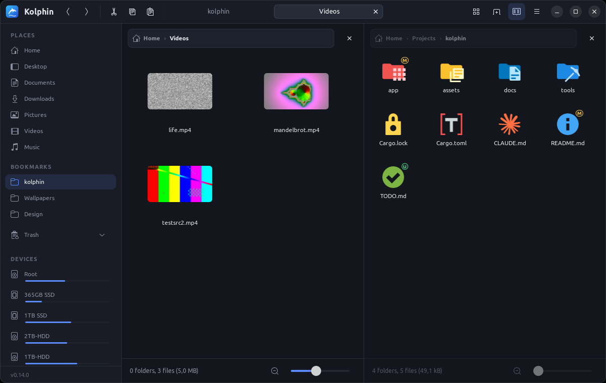
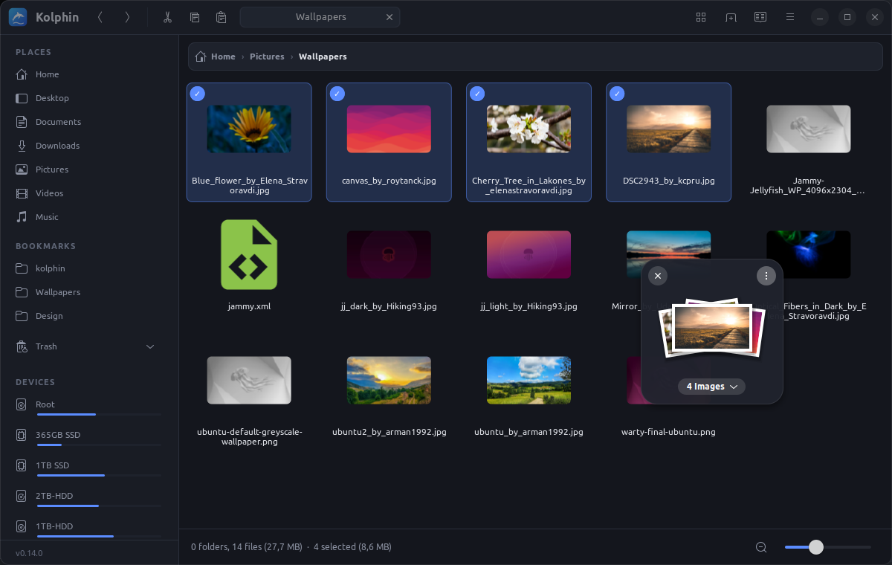
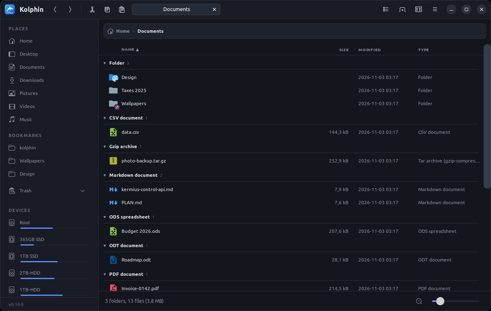
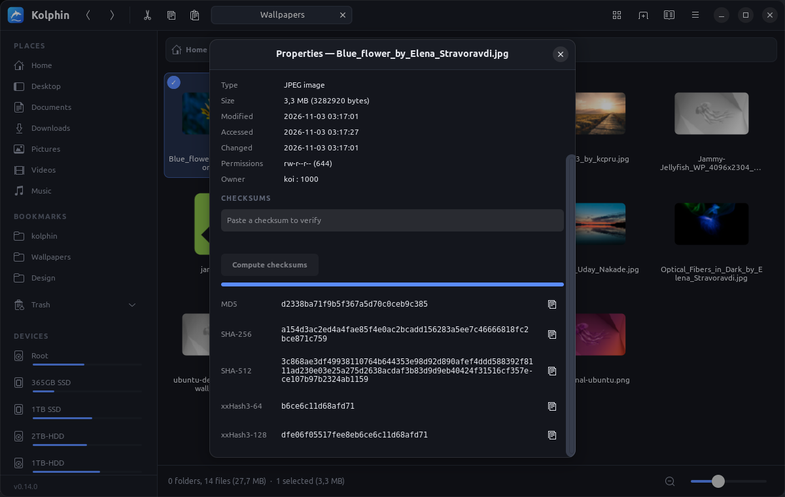
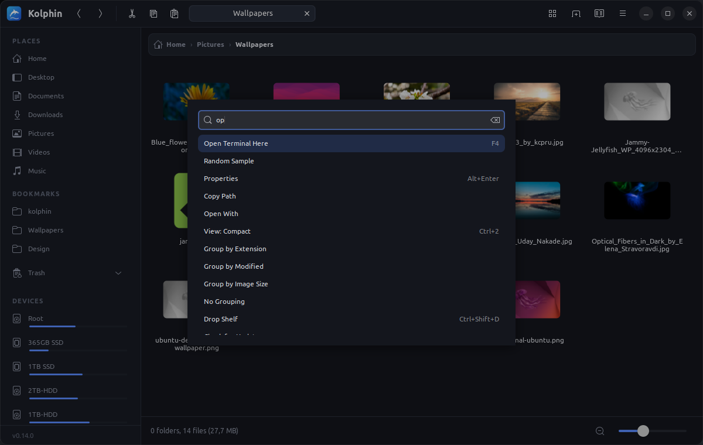

# Kolphin

Koi's Dolphin: a fast, dark file manager for Linux, written in Rust with GTK4. Vibe coded.



## Why

- **Millions of files, slow disks.** The folder view is one custom-drawn, virtualized canvas. Kolphin lists entries
  while it is still reading the folder and loads thumbnails for the visible items first. On a spinning disk, at most
  two jobs read from it at once. On the author's machine a folder of 1,000,000 files lists in 0.7 s and each frame
  draws in under 1 ms.
- **Every folder remembers its view**: mode, sort, grouping, icon size and collapsed groups. Settings are stored in
  `~/.local/share/kolphin/`, never inside your folders. A folder reached through a symlink shares the settings of
  the real folder.
- **Made to drive the [Kermius](#kermius) terminal**: Kolphin opens its own terminal tab, and the tab follows the
  folder you are viewing.

## Features

### Browse

- **Views**: Icons, Compact (scrolls sideways like Dolphin) and Details. The zoom slider sizes icons per folder.
- **Grouping**: group by name, type, extension, size, date modified or image dimensions. Items are sorted within each
  group, and groups can be collapsed.
- **Thumbnails** for images and videos. Kolphin uses the shared freedesktop cache and follows EXIF rotation.
- **Tabs and split view**: F3 splits the view, Ctrl+T opens a tab, and the last session is restored at start.
- **Breadcrumb path bar**: scroll it with the mouse wheel, or click it (or press Ctrl+L) to type a path.
- **Filtering and search**: Ctrl+I filters the current folder. Ctrl+F searches subfolders in parallel and shows
  results as they arrive.
- **Badges**: git status on files in a repository, plus symlink and hard-link markers.



### Select and move

- **Selection checkboxes**: a checkbox appears when you hover an item. Click it to add or remove the item without
  holding Ctrl. Drag on empty space between items to select a rectangle.
- **Copy and move**: transfers run in a background queue with progress and a Cancel button. Cancelling removes the
  half-copied file. When a name already exists, Kolphin asks whether to skip, replace (the old file goes to the
  Trash) or keep both.
- **Undo** (Ctrl+Z) for moves, new items and trashing. **Batch rename** many files at once.
- **Trash**, including the trashes on NTFS and other external drives, with Restore and Empty Trash.
- **Drop Shelf**: shake the pointer while dragging files and a shelf appears. Park files on it and drag them out
  later. You can keep several shelves open and move them anywhere. Ctrl+Shift+D opens one.



### Everything else

- **Command palette** (Ctrl+K): find any action by name.
- **Properties**: copy a file's name, location or path. Compute MD5, SHA-256, SHA-512 and xxHash checksums in one
  pass, or paste a checksum to check it.
- **Archives**: open zip, tar, 7z, rar and iso files as folders, Extract Here, or Compress… to any format.
- **PDF**: Convert to PDF (images, and office documents through LibreOffice), or Merge into PDF: the selected files
  become one PDF in the order you picked them; existing PDFs are kept as they are (merging them uses `pdfunite`).
- **New File / New Document**: empty files (Ctrl+Alt+N), blank Word, Excel, PowerPoint and OpenDocument files that
  open in LibreOffice, ONLYOFFICE, WPS or MS Office, and your own templates from `~/Templates`.
- **Devices**: USB drives can be mounted and ejected, and each drive shows a usage bar; hover it for % used and free
  space.
- **Network**: SMB/SFTP/FTP servers (passwords can be saved), plus the hosts Kolphin finds on your local network.
- **Open With**: pick an app, choose the default app, or open the folder in VS Code, Claude or OpenCode (custom
  actions in `~/.config/kolphin/actions.toml`).
- **System integration**: Kolphin can become the default file manager, so "Show in folder" from browsers and
  other apps opens in Kolphin.
- **Updates**: Kolphin checks GitHub Releases at start and installs a new version with one click.

<p>
  
  
</p>



## Install

Download `kolphin_<version>_amd64.deb` (or `arm64`) from
[Releases](https://github.com/datlt4/Kolphin/releases/latest), then run:

```sh
sudo apt install ./kolphin_*_amd64.deb
```

After this first install, Kolphin updates itself: when a new release is out, click **Update** in the notification.

A plain tarball (`kolphin_<version>_linux_<arch>.tar.gz`) is also published. Run the `kolphin` binary inside it;
the app offers to install itself system-wide.

Kolphin needs Ubuntu 22.04 or newer (GTK 4.6, libadwaita 1.1). These are optional:
- `ffmpegthumbnailer`: video thumbnails.
- `file-roller`: Extract Here and Compress.
- `gvfs-backends`: network shares and archives.

## Build

```sh
sudo apt install libgtk-4-dev libadwaita-1-dev
cargo run --release
```

## Keyboard

| Keys | Action |
|---|---|
| Ctrl+K | Command palette |
| Ctrl+L / F6 | Type a path |
| Ctrl+F / Ctrl+I | Search subfolders / filter this folder |
| Ctrl+1 / 2 / 3 | Icons / Compact / Details |
| Ctrl+T / Ctrl+W | New tab / close tab |
| F3 | Split view |
| F4 | Terminal here |
| F5 | Refresh the folder and the sidebar |
| F2 | Rename |
| Alt+Enter | Properties |
| Ctrl+H | Show hidden files |
| Ctrl+Shift+N | New folder |
| Ctrl+Alt+N | New empty file |
| Ctrl+Shift+D | New Drop Shelf |
| Space | Quick Look |

## Kermius

If [Kermius](docs/kermius-control-api.md) is installed, F4 opens a Kermius tab in the current folder. Kolphin
controls that tab through Kermius's control socket:
- When you change folders in Kolphin, the tab runs `cd` (only while its shell is idle).
- When you `cd` in the tab, Kolphin follows.

Without Kermius, F4 opens your default terminal instead.
